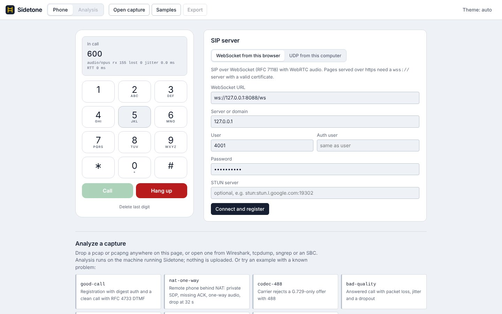
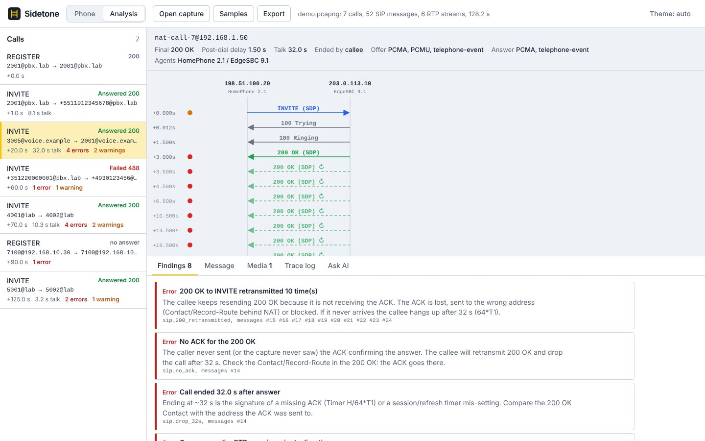
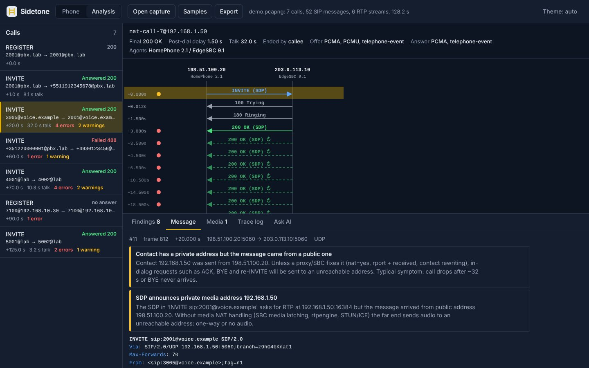
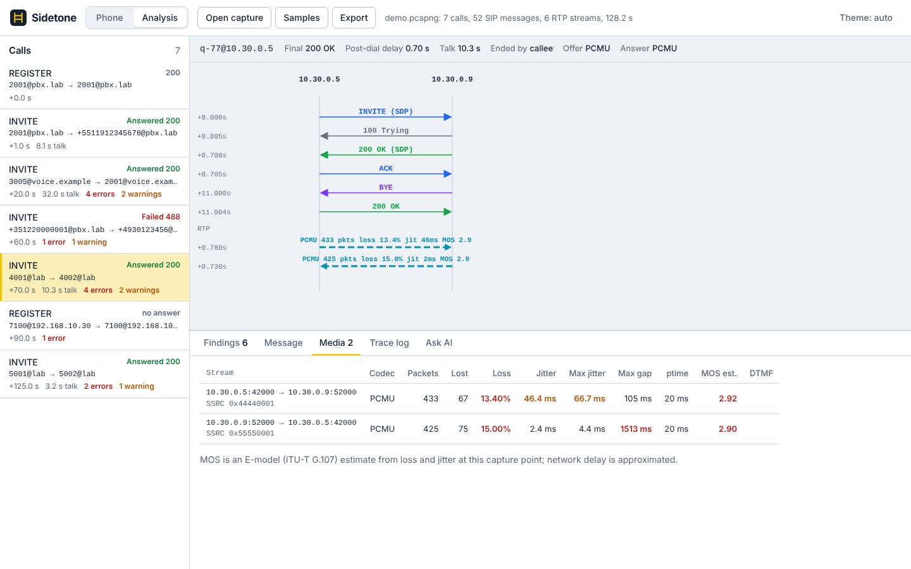
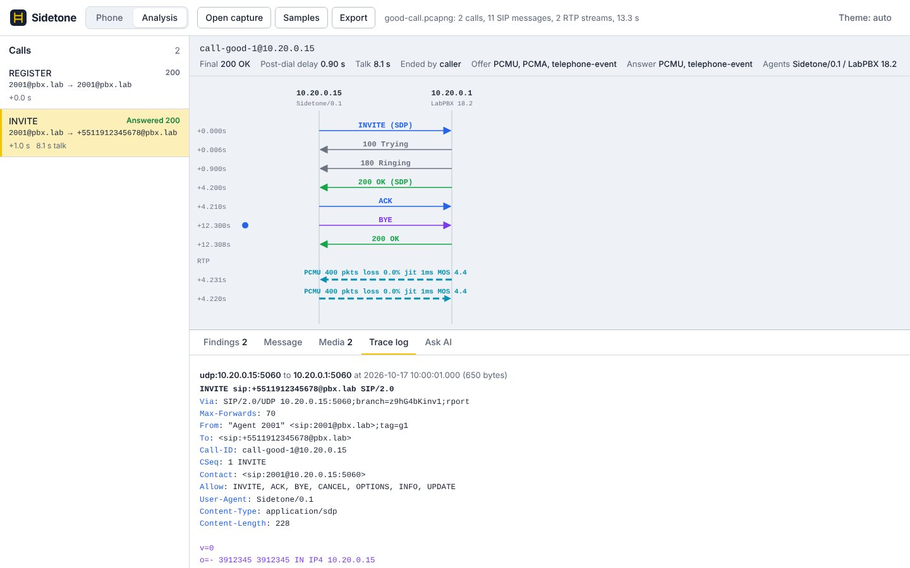
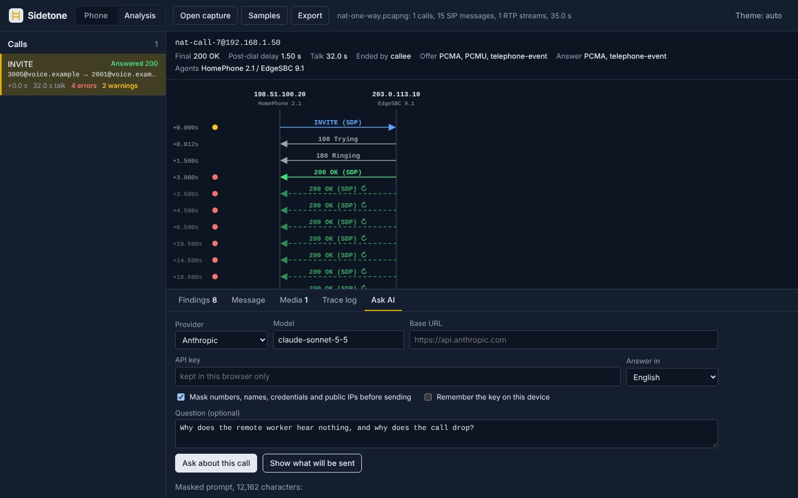
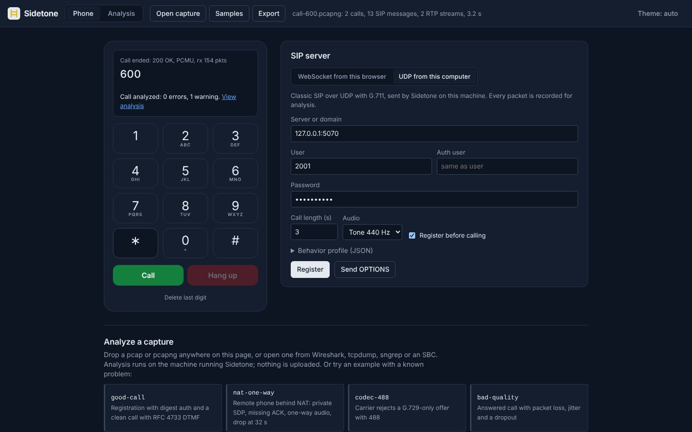

<p align="center">
  
</p>

<h1 align="center">Sidetone</h1>

<p align="center">
  <b>A SIP softphone built for troubleshooting: place the call, see the ladder, and know why it failed.</b><br>
  Test calls over UDP or WebRTC, pcap and pcapng analysis, RTP quality and MOS, plain-language diagnostics,<br>
  an AI second opinion with your own keys, automated test suites and an MCP server, for Windows, macOS, Linux and the browser.
</p>

<p align="center">
  
  
  
  
  
  <a href="https://github.com/igtoth/sidetone/actions/workflows/ci.yml"></a>
</p>

<p align="center">
  <a href="https://github.com/igtoth/sidetone/releases"><b>Download</b></a> &middot;
  <a href="https://igtoth.github.io/sidetone/">Open it in the browser</a> &middot;
  <a href="examples/">Test suite examples</a> &middot;
  <a href="#help-wanted">Contribute</a>
</p>

<p align="center">
  <sub>Alpha: expect rough edges. A capture that Sidetone reads wrong or a finding that misleads? <a href="https://github.com/igtoth/sidetone/issues/new">Open an issue</a> with a redacted pcapng (Export &rsaquo; Redacted pcapng): real traces are what improve the rules most.</sub>
</p>

<br>

<p align="center">
  
  <br>
  <sub>The phone first: a WebRTC call in progress, live getStats() numbers on the display, the SIP server on the right.</sub>
</p>

<p align="center">
  <a href="#features">Features</a> &middot;
  <a href="#everything-in-the-box">Everything in the box</a> &middot;
  <a href="#made-to-be-automated">Automation</a> &middot;
  <a href="#ai-with-your-own-keys">AI</a> &middot;
  <a href="#under-the-hood">Under the hood</a> &middot;
  <a href="#get-started">Get started</a> &middot;
  <a href="#help-wanted">Help wanted</a> &middot;
  <a href="#downloads">Downloads</a>
</p>

<br>

<table>
  <tr>
    <td width="25%" valign="top">
      <h3>A real softphone</h3>
      Register, call, answer, send DTMF. SIP over UDP from the desktop, or SIP over WebSocket with WebRTC audio straight from the browser. Every packet is recorded, no capture driver needed.
    </td>
    <td width="25%" valign="top">
      <h3>It explains the call</h3>
      Around 40 deterministic rules read signaling and media and say what went wrong in words: missing ACK, NAT in SDP, one-way audio, codec mismatch, loss and jitter, with the message numbers as evidence.
    </td>
    <td width="25%" valign="top">
      <h3>Evidence you can share</h3>
      Annotated pcapng with findings as Wireshark packet comments, TLS keys embedded when available, and a redacted export that masks numbers, names, credentials and public IPs.
    </td>
    <td width="25%" valign="top">
      <h3>Ready for scripts and agents</h3>
      A CLI, JSON test suites with JUnit output for CI, and an MCP server so an AI agent can analyze captures and place test calls on its own.
    </td>
  </tr>
</table>

<br>

## Features

Every screenshot is Sidetone itself, captured headless by
`scripts/readme-shots.mjs` against the throwaway PBX in `lab/` and the
built-in sample captures. Some are in the dark theme (the Theme button at
the right of the bar, or your system setting).

<table>
  <tr>
    <td width="50%" valign="top">
      
      <br>
      <sub>A remote worker behind NAT: 200 OK retransmitted ten times, no ACK, drop at 32 s.</sub>
      <h3>The ladder, with the diagnosis on it</h3>
      Calls are grouped by Call-ID with their outcome, post-dial delay, talk time and error count. The ladder marks retransmissions and colours requests, provisional, success and failure responses; a dot on the left shows which messages a finding points to. Click an arrow to read the message.
    </td>
    <td width="50%" valign="top">
      
      <br>
      <sub>The INVITE that started it: private Contact and private SDP address.</sub>
      <h3>Every message, in full</h3>
      Header names highlighted, SDP set apart, parse problems called out (bad Content-Length, folding, missing mandatory headers) and the findings that refer to that exact message shown above it.
    </td>
  </tr>
  <tr>
    <td width="50%" valign="top">
      
      <br>
      <sub>Both directions of a bad call: loss, jitter, a 1.5 s gap and MOS below 3.</sub>
      <h3>Media you can measure</h3>
      Each RTP stream is tied to its call through the SDP: codec, packets, loss with sequence wrap handling, RFC 3550 jitter, the longest gap, ptime, RFC 4733 digits and an ITU-T G.107 E-model MOS estimate. One-way audio, asymmetric RTP and unnegotiated payload types are findings of their own.
    </td>
    <td width="50%" valign="top">
      
      <br>
      <sub>The trace log, desk-phone style: who sent what, when and how big.</sub>
      <h3>The trace log you already know</h3>
      The same call as a plain log, each message headed by transport, source and destination, a millisecond timestamp and its size, the way a desk phone's SIP Trace page shows it.
    </td>
  </tr>
  <tr>
    <td width="50%" valign="top">
      
      <br>
      <sub>Ask AI, with "Show what will be sent" before anything leaves.</sub>
      <h3>An AI second opinion</h3>
      The model gets the findings, the ladder, the RTP statistics and the relevant raw messages, masked by default, and is asked to explain the root cause with evidence and fixes. Anthropic, any OpenAI-compatible service or a local Ollama; preview the exact prompt first.
    </td>
    <td width="50%" valign="top">
      
      <br>
      <sub>A UDP test call from the desktop, analyzed the moment it ends.</sub>
      <h3>Test calls with a behavior profile</h3>
      Over UDP the desktop app places calls with G.711, tone, echo or a WAV file, digest auth, PRACK and DTMF by RFC 4733 or SIP INFO. A behavior profile reproduces difficult clients on purpose: T1, session timers, <code>user=phone</code>, compact headers, long Contact, symmetric RTP, DSCP, even a skipped ACK or a fake SDP address.
    </td>
  </tr>
</table>

<br>

## Everything in the box

<table>
  <tr>
    <td width="33%" valign="top">
      <h4>About 40 diagnostic rules</h4>
      INVITE without response &middot; failure codes explained &middot; 200 OK retransmitted &middot; no ACK &middot; drop at 32 s &middot; session timer expiry &middot; credentials rejected &middot; challenge not answered &middot; 481 in dialog &middot; glare &middot; slow first response &middot; post-dial delay &middot; private SDP or Contact behind a public source &middot; wrong interface on an unanswered REGISTER &middot; no common codec &middot; answer with codecs not offered &middot; SRTP vs RTP &middot; missing crypto or fingerprint &middot; DTLS role conflict &middot; DTMF not negotiated &middot; ptime mismatch &middot; hold &middot; one-way audio &middot; no RTP &middot; asymmetric RTP &middot; loss &middot; jitter &middot; gaps &middot; SSRC change &middot; unnegotiated payload types &middot; low MOS &middot; Q.850 Reason causes &middot; missing mandatory headers &middot; Content-Length errors &middot; Max-Forwards near zero
    </td>
    <td width="33%" valign="top">
      <h4>Captures in and out</h4>
      Read: pcap and pcapng (Ethernet, VLAN, Linux cooked v1 and v2, raw IP, loopback), IPv4 and IPv6, SIP over UDP and TCP, TLS key logs from pcapng.
      <br><br>
      Write: annotated pcapng with findings as packet comments and TLS keys kept; redacted pcapng for sharing; one call or the whole capture; ladder as SVG; report as JSON; stereo WAV of each test call (left sent, right received).
    </td>
    <td width="33%" valign="top">
      <h4>The phone</h4>
      REGISTER with digest (MD5, qop auth) &middot; INVITE, PRACK, ACK, BYE, CANCEL, INFO, UPDATE &middot; answer mode with echo &middot; G.711 &mu;-law and A-law &middot; RFC 4733 and SIP INFO DTMF &middot; session refresh &middot; route-based choice of the local interface &middot; in-process capture &middot; WebRTC web phone with Opus, ICE and DTLS-SRTP, incoming calls and getStats()
    </td>
  </tr>
  <tr>
    <td width="33%" valign="top">
      <h4>Command line</h4>
      <code>analyze</code> &middot; <code>export</code> &middot; <code>ai</code> &middot; <code>call</code> &middot; <code>answer</code> &middot; <code>register</code> &middot; <code>options</code> &middot; <code>test</code> &middot; <code>test-gen</code> &middot; <code>test-format</code> &middot; <code>samples</code> &middot; <code>profile</code> &middot; <code>serve</code> &middot; <code>mcp</code>
    </td>
    <td width="33%" valign="top">
      <h4>MCP tools</h4>
      <code>analyze_capture</code> &middot; <code>get_ladder</code> &middot; <code>get_message</code> &middot; <code>get_call_context</code> &middot; <code>export_pcapng</code> &middot; <code>generate_sample</code> &middot; <code>sip_options</code> &middot; <code>test_call</code> &middot; <code>get_test_suite_format</code> &middot; <code>run_test_suite</code>
    </td>
    <td width="33%" valign="top">
      <h4>Built-in examples</h4>
      Seven synthetic captures with known problems, so every rule can be seen without real customer traffic: a clean call with DTMF, NAT with one-way audio and a 32 s drop, a 488 codec rejection, a lossy call, a REGISTER that never gets an answer, an SRTP mismatch, and all of them together.
    </td>
  </tr>
</table>

<br>

## Made to be automated

The CLI and the web app share one engine, so anything the window does, a
script does too.

```sh
# Read a capture: calls, ladder, RTP, findings
sidetone analyze trace.pcapng --ladder
sidetone analyze trace.pcapng --call 3 --svg call3.svg
sidetone analyze trace.pcapng --json > report.json

# Share it: findings as Wireshark comments, or masked for a vendor ticket
sidetone export trace.pcapng -o annotated.pcapng
sidetone export trace.pcapng -o share.pcapng --call 3 --redact

# Place calls from a script, then read what happened
sidetone call 600 --domain pbx.lab:5060 --user 2001 --password "$PW" \
  --register --dtmf 123# --pcap call.pcapng --wav call.wav
sidetone answer --domain pbx.lab --user 3001 --password "$PW" --register --audio echo
sidetone options pbx.lab
```

Test suites are JSON: cases made of `register`, `options`, `call`, `wait`
and `unregister` steps, each with expectations (final status, maximum
errors, minimum MOS, loss, jitter, post-dial delay, talk time, codec, RTP
received, rules that must or must not appear). Each case saves its pcapng.

```sh
SIP_PASSWORD=... sidetone test examples/asterisk-lab.suite.json --junit junit.xml
sidetone test suite.json --ai-explain     # failed cases get an AI explanation
sidetone test-gen "register 2001 on pbx.lab and check echo 600 with DTMF and MOS above 4" -o new.suite.json
```

```json
{ "name": "echo test with DTMF",
  "steps": [ { "call": { "target": "600", "duration": 4, "dtmf": "123#",
      "expect": { "status": 200, "min_mos": 4.0, "rtp_received": true,
                  "rules_present": ["rtp.dtmf"], "rules_absent": ["rtp.one_way"] } } } ] }
```

Serve the analyzer and the phone to an AI agent over the Model Context Protocol:

```json
{ "mcpServers": { "sidetone": { "command": "/path/to/sidetone", "args": ["mcp"] } } }
```

## AI with your own keys

Sidetone has no AI of its own and no account. Detection is deterministic;
the model is only asked to interpret, which keeps answers grounded and
cheap. Pick Anthropic, any OpenAI-compatible endpoint (a gateway, LM Studio,
vLLM) or a local Ollama; nothing is sent until you ask, masking is on by
default, and "Show what will be sent" prints the exact prompt.

```sh
export ANTHROPIC_API_KEY=...
sidetone ai trace.pcapng --call 2 --lang "Portuguese (Brazil)"
sidetone ai trace.pcapng --provider ollama --model llama3.1
sidetone ai trace.pcapng --dry-run
```

In the browser the key stays in that browser and goes only to the provider;
Ollama needs `OLLAMA_ORIGINS` to include the page origin.

## Under the hood

- **Engine first:** `crates/sidetone-core` holds capture I/O, SIP/SDP/RTP
  parsing, call correlation, the rules, the ladder, export, redaction and
  the AI prompt, with no network or audio code, so it runs natively and as
  WebAssembly.
- **One frontend, three homes:** `web/` runs on GitHub Pages with the
  analyzer in WASM, behind `sidetone serve`, and inside the Tauri desktop
  app, which starts the local server on a random loopback port protected by
  a per-launch token.
- **Capture without drivers:** the phone records its own datagrams with
  real addresses and timestamps, so no Npcap, libpcap or root is needed.
- **The interface the OS would use:** the local address comes from the
  route to the server, so a VPN or virtual adapter does not end up in Via,
  Contact and SDP.
- **Tested against a real PBX:** CI runs unit tests on Linux, Windows and
  macOS, builds the WASM, starts Asterisk from `lab/` and runs the example
  suite, and opens every exported capture with tshark.

## Get started

```sh
git clone https://github.com/igtoth/sidetone
cd sidetone
cargo run --release -p sidetone-cli -- serve      # phone and analyzer on http://127.0.0.1:8640
cargo run --release -p sidetone-cli -- samples ./samples
cargo test --workspace --exclude sidetone-desktop
```

A recent stable Rust (CI uses stable). The desktop app builds with
`npx @tauri-apps/cli@2 build` in `app/`; on Linux it needs WebKitGTK 4.1.
For a local PBX to call: `lab/run-asterisk.sh` (Asterisk with UDP,
WebSocket and WebRTC endpoints, echo, busy and unallocated numbers).

> [!IMPORTANT]
> **Status: alpha.** The analyzer, the UDP phone, the web phone, test
> suites and the MCP server work and are covered by tests and a live PBX
> in CI, but Sidetone is young. Not yet there: SIP over TCP/TLS, SRTP and
> Opus in the native phone, passive capture of other hosts' traffic, DNS
> SRV/NAPTR, and an interactive hang-up for native calls (they run for a
> set length). MOS is an estimate from one capture point.

## Help wanted

- **Try it on your own traces.** A capture Sidetone reads wrong, or a
  finding that misleads, sent as a redacted pcapng in
  [an issue](https://github.com/igtoth/sidetone/issues/new), improves the
  rules more than anything else.
- **Write a rule.** Each rule is a few lines in
  `crates/sidetone-core/src/rules.rs` plus a synthetic scenario in
  `synth.rs` that proves it.
- **Share a test suite** for your PBX, SBC or carrier in `examples/`.
- **Package it** for the system you use (Homebrew, winget, AUR, Flatpak).

## Downloads

Each version tag builds installers for every platform:
take the [latest release](https://github.com/igtoth/sidetone/releases/latest).

| Platform | Files |
|---|---|
| Windows (x64) | MSI and NSIS installers of the desktop app, `sidetone-<version>-x86_64-pc-windows-msvc.zip` with the CLI (not signed yet: if SmartScreen warns, More info &rsaquo; Run anyway) |
| macOS (Apple silicon, Intel) | `.dmg` of the desktop app, CLI archives for `aarch64` and `x86_64` (unsigned for now: right-click, Open) |
| Linux (x86_64, arm64 CLI) | `.deb`, `.rpm` and AppImage of the desktop app, CLI archives |
| Web | no download: [open it in the browser](https://igtoth.github.io/sidetone/) |

## Documentation

| Where | What it covers |
|---|---|
| `sidetone --help`, `sidetone test-format` | every command and the test suite format |
| [`examples/`](examples/) | test suites, including one that fails on purpose |
| [`lab/`](lab/) | the Asterisk lab used by CI and the screenshots |
| [`crates/sidetone-core/src/rules.rs`](crates/sidetone-core/src/rules.rs) | every rule and its explanation |
| [`crates/sidetone-core/src/synth.rs`](crates/sidetone-core/src/synth.rs) | the sample scenarios |
| [`.github/workflows/`](.github/workflows/) | CI, releases and the GitHub Pages build |

---

## License and credits

Sidetone is licensed under the [MIT License](LICENSE).
Copyright &copy; 2026 Ighor Toth.

Written by Ighor Toth with Claude Code, Anthropic's AI coding assistant,
as co-author: commits it helped write carry a `Co-Authored-By` line.

The interface uses IBM Plex Sans and IBM Plex Mono (SIL Open Font License),
loaded from Google Fonts. Every capture in the screenshots and samples was
made for Sidetone.

<sub>Sidetone is an independent open-source project, not affiliated with,
sponsored by or endorsed by any other software vendor. Product names such as
Wireshark and Asterisk belong to their owners and are used only to describe
compatibility. The software is provided "as is", without warranty of any
kind, as the license states.</sub>
